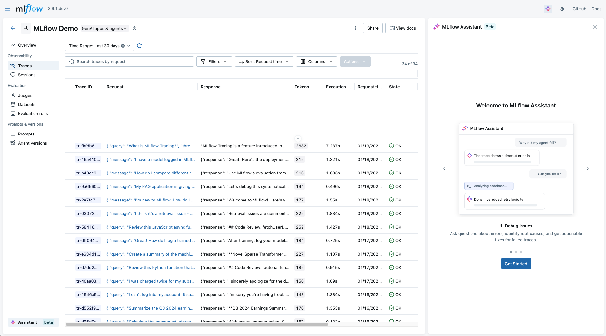
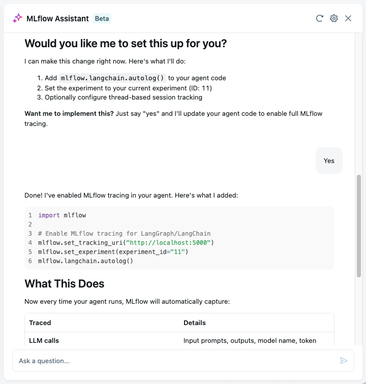
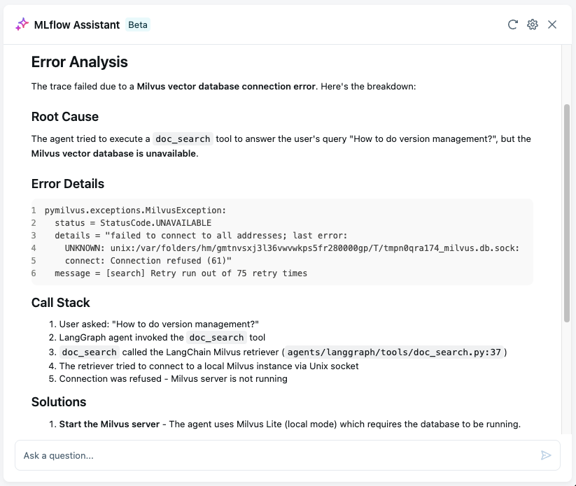
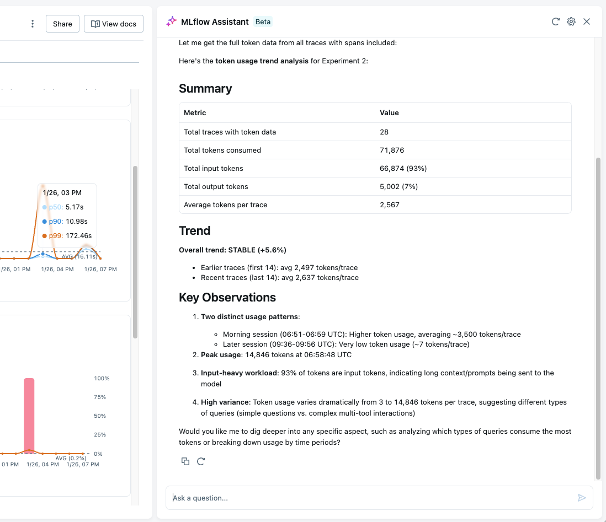
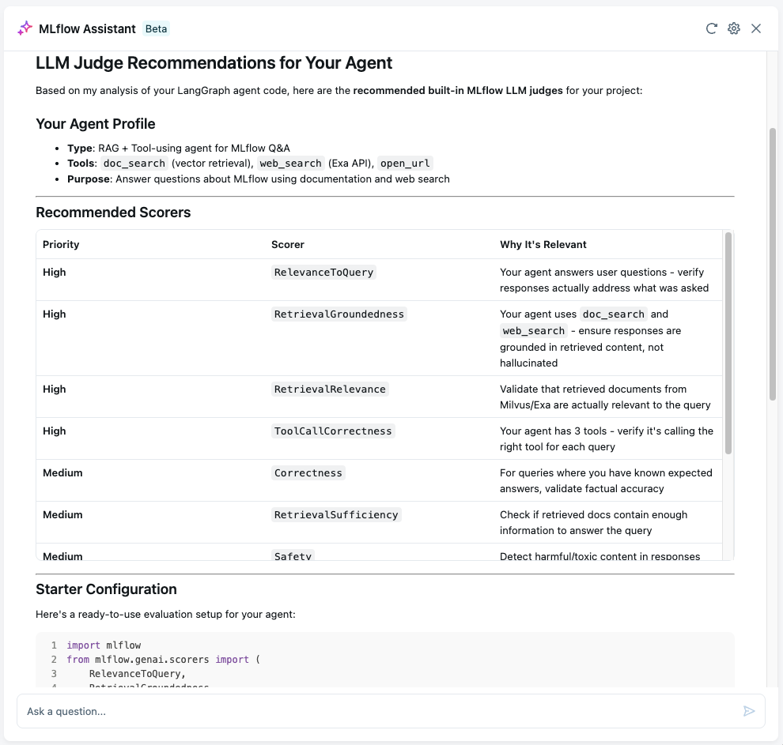
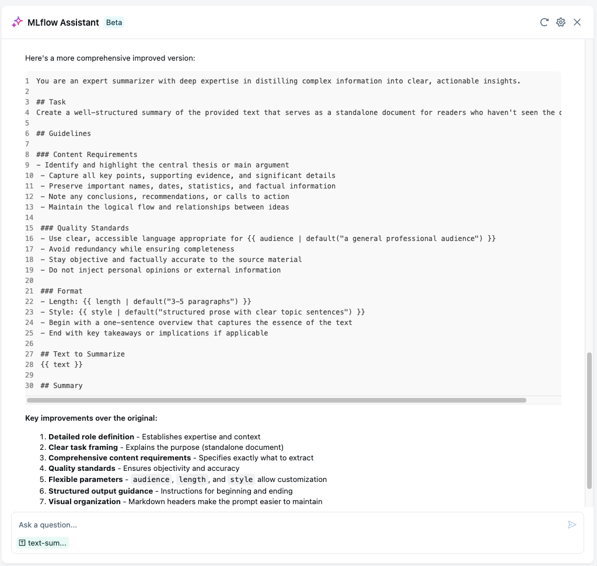

# MLflow AI Assistant

The MLflow AI Assistant is a powerful AI-powered helper that transforms cutting-edge coding agents like Claude Code into experienced AI engineers by your side. Unlike typical chatbots, MLflow AI Assistant is **aware of your codebase and context**. It is not just a question-answering tool, but a full-fledged AI engineer that can find root causes for issues, set up quality tests, and apply [LLMOps](https://mlflow.org/llmops) best practices to your project.

## What's Unique About MLflow AI Assistant?[​](#whats-unique-about-mlflow-ai-assistant "Direct link to What's Unique About MLflow AI Assistant?")

#### No Additional Costs

Use your existing coding agent subscription (Claude Code, etc.) and pay nothing extra. MLflow provides the knowledge and integration at no cost.

#### Context Rich

The assistant understands your local codebase, project structure, and LLMOps best practices. It provides tailored recommendations for your specific project, not generic advice.

#### Complete Dev-Loop

Go beyond Q\&A. The assistant can fetch MLflow data, read your code, and even add tracing, evaluation, and versioning to your project without human intervention.

#### Fully Customizable

Add custom skills, sub-agents, and permissions. Everything runs on your machine with full transparency. Not a black box solution behind paywall.

## Example Use Cases[​](#example-use-cases "Direct link to Example Use Cases")

Explore the use cases below to see MLflow AI Assistant in action.

* Set Up MLflow
* Debug Issues
* Analyze Data
* Evaluate Quality
* Improve Prompts

#### Set Up MLflow for You[​](#set-up-mlflow-for-you "Direct link to Set Up MLflow for You")

 

Just ask **"How do I set up MLflow for my project?"** and the assistant will guide you through the process of setting up MLflow for your project. Since the assistant has access to your codebase, it can automatically understand what you are trying to build and determine the required setup steps.

 

 

#### Analyze Traces and Debug Issues[​](#analyze-traces-and-debug-issues "Direct link to Analyze Traces and Debug Issues")

 

When something goes wrong, the assistant can search through your traces, identify patterns, and help you understand what happened.

 

 

#### Analyze Bulk Data and Identify Patterns[​](#analyze-bulk-data-and-identify-patterns "Direct link to Analyze Bulk Data and Identify Patterns")

 

The assistant can analyze bulk data stored in your experiments and identify patterns that suggest improvements to your application.

 

 

#### Setting Up Robust Evaluation For Your Project[​](#setting-up-robust-evaluation-for-your-project "Direct link to Setting Up Robust Evaluation For Your Project")

 

Evaluation is important for the success of ML/AI projects, however, getting it right is challenging. The assistant helps you set up the robust evaluation framework tailored to your project with deep understanding of the codebase and LLMOps best practices.

 

 

#### Improve Prompt Templates with AI Wizard[​](#improve-prompt-templates-with-ai-wizard "Direct link to Improve Prompt Templates with AI Wizard")

 

Prompt engineering is still a critical part of building LLM applications, yet manually iterating over prompts is time-consuming and error-prone. The assistant helps you improve prompt templates and frees you from the repetitive work.

 

 

warning

MLflow AI Assistant is in beta. By default, it works only in a browser on the machine that runs the MLflow server. Using it from other machines is experimental: set `MLFLOW_ENABLE_REMOTE_ASSISTANT=true` on a server that has Docker, which runs the assistant's tools in a Docker sandbox, for local users too (Claude Code and Codex then run only in a sandbox image that you build). Users on other machines can use only MLflow AI Gateway endpoints, and they can change Assistant settings only on a server with authentication. See the [Assistant sandbox guide](https://github.com/mlflow/mlflow/blob/master/mlflow/server/sandbox/README.md).

## Getting Started[​](#getting-started "Direct link to Getting Started")

Set up MLflow AI Assistant with the backend you prefer: the **Claude Code** or **Codex** CLI, local models through **Ollama**, or a hosted model (for example from OpenAI, Anthropic, or Gemini) through an **MLflow AI Gateway** endpoint.

### 1. Open MLflow UI[​](#1-open-mlflow-ui "Direct link to 1. Open MLflow UI")

Open MLflow UI at <http://localhost:5000> or your custom port.

### 2. Open Assistant Panel[​](#2-open-assistant-panel "Direct link to 2. Open Assistant Panel")

If you are using the local MLflow server, the Assistant panel should open automatically. If not, you can navigate to it manually by clicking the Assistant tab on the left sidebar in the experiment page.

### 3. Follow the setup wizard[​](#3-follow-the-setup-wizard "Direct link to 3. Follow the setup wizard")

Follow the setup wizard to configure the assistant. For example, if you select Claude Code as the backend, you will be asked to log in to Claude Code. Configurations you make here can be changed later from the Assistant setting page (the gear icon at the top).

### 4. Start chatting[​](#4-start-chatting "Direct link to 4. Start chatting")

Once the setup is complete, you can start chatting with the assistant. Note that the assistant only works when you are in an experiment page. If you are outside of an experiment page, it will prompt you to select or create an experiment.

## FAQ & Troubleshooting[​](#faq--troubleshooting "Direct link to FAQ & Troubleshooting")

**Is MLflow AI Assistant really free?**

Yes! MLflow AI Assistant uses your existing coding agent subscription or model provider account. You pay for the agent or model you use (for example Claude Code, or a hosted model's API charges), but MLflow provides the knowledge and integration at no cost. There are no additional fees, premium tiers, or usage limits from MLflow's side.

**Which backends are supported?**

**Claude Code** and the **Codex** CLI. The assistant can also use local models through **Ollama**, and hosted models (for example from OpenAI, Anthropic, or Gemini) through an **MLflow AI Gateway** endpoint.

**Does the assistant have access to my data?**

The assistant runs on the machine that runs the MLflow server. To answer you, it sends your messages, and the MLflow data and code it reads, to the model of the backend you choose: the model provider of Claude Code or Codex, the provider of a hosted model behind an MLflow AI Gateway endpoint, or a local Ollama model, which keeps everything on your machine. Linking a project path in the settings sets the folder the assistant works in, but it does not limit what the assistant can read: without the sandbox, the coding agent can read files that the server's user can read, depending on the backend and the permissions you grant (with **Full access**, any of them).

**Can I customize what the assistant can do?**

Absolutely! Coding agents like Claude Code support:

* **Custom skills**: Add specialized capabilities for your workflow
* **Permissions**: Control what files and operations the agent can access
* **Sub-agents**: Create specialized agents for different tasks
* **Custom prompts**: Configure system prompts and behavior

You have full control over what the assistant can access and modify.

**Assistant asks for a permission I didn't grant. What should I do?**

Depending on the question you asked, Assistant may think it needs an action that you didn't grant permission for. MLflow UI does not support ad-hoc permission approval yet, but you can update the permissions from the Assistant setting page.

* **Execute MLflow CLI**: The assistant will have access to run MLflow CLI commands to fetch traces, runs, and experiment data. This is required for the assistant to work.
* **Read MLflow documentation**: The assistant will have access to read the latest MLflow documentation. This is optional but highly recommended for getting the best out of the assistant.
* **Edit project code**: The assistant will have access to edit your project code. This is optional and only required if you want the assistant to update your project code for fixing issues, adding tracing, and applying LLMOps best practices.
* **Full access**: This will grant the assistant full access to the Assistant. For example, enabling this will run Claude Code with the `bypassPermissions` mode.

To give more granular control, you can also edit the permission setting of your backend coding agent directly. For example, if you are using Claude Code, you can edit `.claude/settings.json` file in your home directory or a project-scoped one.
