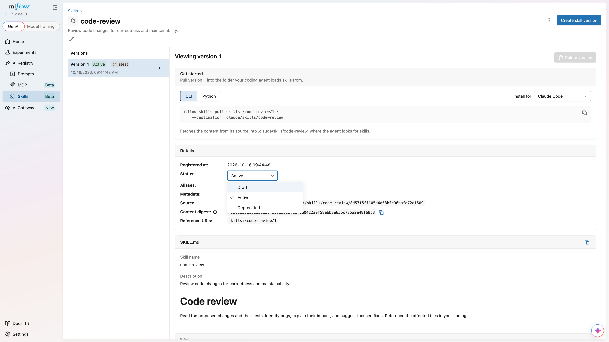
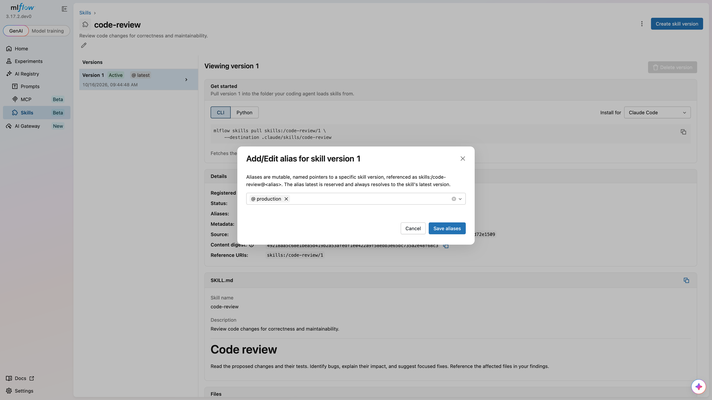
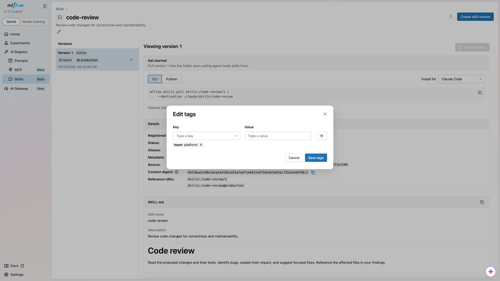
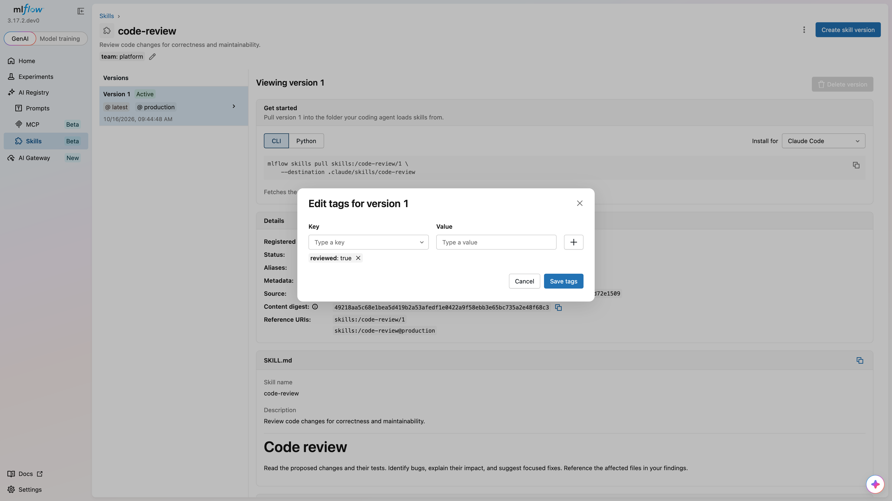

# Manage Versions and Aliases

Skill Registry uses numbered versions and aliases to control which skill content your users and agents use. This guide covers version management, status transitions, aliases, and tags.

The examples use [`mlflow.client.MlflowClient()`](/docs/3.18.0/api_reference/python_api/mlflow.client.html#mlflow.client.MlflowClient) and use the unscoped `code-review` skill created in [Getting Started](/docs/3.18.0/genai/skill-registry.md#getting-started), which starts with an active version `1`. Set the tracking URI to your MLflow server before running them.

## Version Numbers[​](#version-numbers "Direct link to Version Numbers")

MLflow assigns each new skill version an increasing integer, starting at `1`. Version numbers are not reused after a version is soft-deleted. Register updated content under the same skill name and organization to create another version.

## Status Lifecycle[​](#status-lifecycle "Direct link to Status Lifecycle")

Each version has a status that controls its availability:

| Status         | Description                                                      |
| -------------- | ---------------------------------------------------------------- |
| **Draft**      | Being prepared. Still readable and pullable by version or alias. |
| **Active**     | Ready for use. Preferred when resolving the latest version.      |
| **Deprecated** | Still accessible but should be replaced.                         |
| **Deleted**    | Excluded from normal reads, searches, and pulls.                 |

New versions start as `active` unless you request `draft`.

### Allowed Transitions[​](#allowed-transitions "Direct link to Allowed Transitions")

* `draft` → `active` or `deleted`
* `active` → `draft` or `deprecated`
* `deprecated` → `active` or `deleted`

Deleted versions cannot change status. A transition to the current status is rejected.

### Update Version Status[​](#update-version-status "Direct link to Update Version Status")

* UI
* Python
* CLI



1. Open the skill detail page.
2. Select the version you want to update from the version list.
3. Click the pencil next to **Status** in the **Details** section.
4. Select the new status.

Use [`mlflow.client.MlflowClient.update_skill_version()`](/docs/3.18.0/api_reference/python_api/mlflow.client.html#mlflow.client.MlflowClient.update_skill_version) to change status:

python

```
from mlflow import MlflowClient


client = MlflowClient()

client.update_skill_version(name="code-review", version=1, status="deprecated")
```

bash

```
mlflow skills update-version skills:/code-review/1 --status deprecated
```

## Aliases[​](#aliases "Direct link to Aliases")

Aliases let you reference a version by a meaningful label, such as `production` or `staging`, instead of a version number. Move an alias to a newer version without changing the URI your users pull.

### Create an Alias[​](#create-an-alias "Direct link to Create an Alias")

* UI
* Python
* CLI



1. Open the skill detail page and select a version.
2. Click the pencil next to **Aliases** in the **Details** section.
3. Enter an alias name and save.

python

```
from mlflow import MlflowClient


client = MlflowClient()

client.set_skill_alias(name="code-review", alias="production", version=1)
```

bash

```
mlflow skills set-alias skills:/code-review --alias production --version 1
```

Setting an existing alias changes its target. Aliases can point to draft or deprecated versions. Deleting a version removes the aliases that point to it and preserves aliases to other versions.

### Resolve a Version by Alias[​](#resolve-a-version-by-alias "Direct link to Resolve a Version by Alias")

python

```
from mlflow import MlflowClient


client = MlflowClient()

version = client.get_skill_version_by_alias(name="code-review", alias="production")

print(f"Production is version {version.version}")
```

bash

```
mlflow skills get-version skills:/code-review@production
```

### Reserved `latest` Alias[​](#reserved-latest-alias "Direct link to reserved-latest-alias")

The `latest` alias is reserved and cannot be assigned or deleted. It follows the resolution rules below. Version-like aliases such as `v1` are also reserved.

#### Latest Version Resolution[​](#latest-version-resolution "Direct link to Latest Version Resolution")

The latest version is selected in this order:

1. The highest-numbered active version.
2. If there are no active versions, the highest-numbered draft or deprecated version.
3. If there are no non-deleted versions, no latest version.

For example, active version `9` takes precedence over draft version `10`. If version `9` is deprecated, version `10` becomes the latest.

The parent skill's `latest_version`, `status`, and `source_type` are derived from this resolved version. A parent with no non-deleted versions remains accessible, but these fields are `None` and a latest-version lookup fails.

python

```
from mlflow import MlflowClient


client = MlflowClient()

latest = client.get_latest_skill_version(name="code-review")

print(latest.version, latest.status)
```

### Delete an Alias[​](#delete-an-alias "Direct link to Delete an Alias")

python

```
from mlflow import MlflowClient


client = MlflowClient()

client.delete_skill_alias(name="code-review", alias="production")
```

## Tags[​](#tags "Direct link to Tags")

Tags are key-value pairs you can attach to skills and versions for organization and filtering. Parent tags and version tags are separate.

### Skill Tags[​](#skill-tags "Direct link to Skill Tags")

* UI
* Python



1. Open the `code-review` skill detail page.
2. Click the pencil below the skill description to edit skill tags.
3. Enter `team` as the **Key** and `platform` as the **Value**, then click **+**.
4. Click **Save tags**.

python

```
from mlflow import MlflowClient


client = MlflowClient()

client.set_skill_tag(name="code-review", key="team", value="platform")


# Optional cleanup when the tag is no longer needed:

# client.delete_skill_tag(name="code-review", key="team")
```

### Version Tags[​](#version-tags "Direct link to Version Tags")

The UI labels version tags as **Metadata** in the version's **Details** section.

* UI
* Python



1. Open the `code-review` skill detail page and select version **1**.
2. Click the pencil beside **Metadata** in the **Details** section.
3. Enter `reviewed` as the **Key** and `true` as the **Value**, then click **+**.
4. Click **Save tags**.

python

```
from mlflow import MlflowClient


client = MlflowClient()

client.set_skill_version_tag(name="code-review", version=1, key="reviewed", value="true")


# Optional cleanup for this version only:

# client.delete_skill_version_tag(name="code-review", version=1, key="reviewed")
```

## Search and Pagination[​](#search-and-pagination "Direct link to Search and Pagination")

Use [`mlflow.genai.search_skills()`](/docs/3.18.0/api_reference/python_api/mlflow.genai.html#mlflow.genai.search_skills) or `MlflowClient.search_skills()` to search parents:

python

```
import mlflow


page_token = None

while True:

    page = mlflow.genai.search_skills(

        filter_string="name = 'code-review' AND tags.team = 'platform'",

        order_by=["name ASC"],

        max_results=20,

        page_token=page_token,

    )

    for skill in page:

        print(skill.name, skill.latest_version, skill.status)

    page_token = page.token

    if page_token is None:

        break
```

Reuse the same filter and ordering when continuing with a page token. Results are limited to skills the caller can read. To select exact identities, pass `include_skill_identities=["code-review"]`; an empty list selects none.

Parent filters on `status` and `source_type` use the same latest-resolved version that supplies the parent's derived values. They do not match arbitrary historical versions. For example, `status = 'active' AND source_type = 'git'` requires the resolved version to have both values.

To search versions of one skill, use `search_skill_versions()`. Its tag filters apply to version tags:

python

```
from mlflow import MlflowClient


client = MlflowClient()

versions = client.search_skill_versions(

    name="code-review",

    filter_string="status = 'deprecated'",

    order_by=["version DESC"],

)

for version in versions:

    print(version.version, version.status)
```

bash

```
mlflow skills search --filter-string "name = 'code-review'" --output json

mlflow skills search-versions skills:/code-review --order-by "version DESC"
```

`mlflow skills list` and `mlflow skills view` inspect skills bundled with MLflow. Use `mlflow skills search` for the registry catalog.

## Delete a Version[​](#delete-a-version "Direct link to Delete a Version")

An active version must move to draft or deprecated status before deletion. This example assumes version `1` has already been deprecated as shown above:

python

```
from mlflow import MlflowClient


client = MlflowClient()

client.delete_skill_version(name="code-review", version=1)
```

Soft deletion retains the version record and its number, but removes its aliases and makes it unavailable to normal reads and pulls. To remove the entire skill, see [Update and Delete Skills](/docs/3.18.0/genai/skill-registry/register-and-import-skills.md#update-and-delete-skills).
