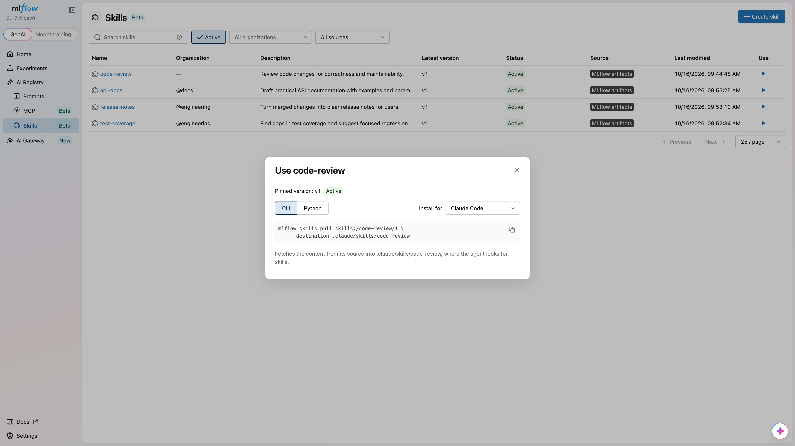

# Pull Skills

Pulling downloads a registered skill's `SKILL.md` and supporting files into a local directory. You can select a version, use an alias, or let MLflow resolve the latest version.

This guide covers pulling skills, generating instructions for your agent, and accessing and verifying source content. Set `MLFLOW_TRACKING_URI` to the server that holds the registry metadata.

## Download a Skill[​](#download-a-skill "Direct link to Download a Skill")

Use [`mlflow.genai.pull()`](/docs/3.18.0/api_reference/python_api/mlflow.genai.html#mlflow.genai.pull) or `mlflow skills pull` to fetch a skill:

* UI
* Python
* CLI



1. Click **Use** on a skill in the catalog.
2. Choose an agent under **Install for**.
3. Select **CLI** or **Python** and copy the command.
4. Run the command in your environment.

To pull a specific version, open the skill detail page, select the version, and copy the command from **Get started**.

python

```
import mlflow


path = mlflow.genai.pull(

    "skills:/code-review@production",

    destination="./downloaded-review",

)

print(path)
```

bash

```
mlflow skills pull skills:/code-review@production --destination ./downloaded-review
```

The Python and CLI examples use the unscoped `code-review` skill from [Getting Started](/docs/3.18.0/genai/skill-registry.md#getting-started) and assume that its `production` alias exists. See [Create an Alias](/docs/3.18.0/genai/skill-registry/manage-versions-and-aliases.md#create-an-alias).

### Choose a Version[​](#choose-a-version "Direct link to Choose a Version")

| URI                              | Selection                              |
| -------------------------------- | -------------------------------------- |
| `skills:/code-review/1`          | Exact version `1` of an unscoped skill |
| `skills:/code-review@production` | The version assigned to `production`   |
| `skills:/code-review`            | The latest-resolved version            |
| `skills:/code-review@latest`     | The same dynamic latest resolution     |

### Choose a Destination[​](#choose-a-destination "Direct link to Choose a Destination")

The default destination is a directory named after the skill in the current working directory. A destination must not exist or must be an empty directory. Files, symbolic links, and nonempty directories are rejected. Choose a fresh destination when repeating a pull.

## Pull Instructions[​](#pull-instructions "Direct link to Pull Instructions")

The UI generates CLI and Python commands with a destination for the agent you select under **Install for**:

| Selection      | Destination for `code-review` |
| -------------- | ----------------------------- |
| Claude Code    | `.claude/skills/code-review`  |
| Codex          | `.agents/skills/code-review`  |
| Cursor         | `.cursor/skills/code-review`  |
| GitHub Copilot | `.github/skills/code-review`  |
| Any directory  | `./skills/code-review`        |

Run the generated command from your project directory, or change its destination to suit your setup. Pulling writes files; it does not execute scripts or change your agent's configuration. Follow your agent's instructions for loading the downloaded skill.

## Source Access and Credentials[​](#source-access-and-credentials "Direct link to Source Access and Credentials")

The client reads the version metadata from MLflow, then fetches the recorded source and subpath. External content is fetched directly by the client, not proxied through the registry server.

| Source           | Required access                                                                                      |
| ---------------- | ---------------------------------------------------------------------------------------------------- |
| Git              | Git installed and credentials that can read the repository, such as a credential helper or SSH agent |
| OCI              | Access to the image, using Docker or container runtime credentials and credential helpers            |
| ZIP              | A publicly accessible URL; ZIP fetches do not attach credentials                                     |
| MLflow artifacts | Access through the configured MLflow artifact repository and its authentication                      |

Permission to read the registry entry does not grant access to a private Git repository or OCI image. The user who pulls the skill must have the required source credentials.

## Content Verification[​](#content-verification "Direct link to Content Verification")

When the version has a recorded digest, the client calculates the fetched tree's digest and requires an exact match. If the source has changed, the pull fails. Register the changed content as a new version, or restore access to the original content before retrying.

A version registered without a digest can still be pulled, but content verification is skipped. High-level `register_skill()` and `import_skills()` calls calculate digests automatically.

Content is staged and checked before it is written to the destination. A source, authorization, or digest failure leaves an absent destination absent and an existing empty destination empty. The selected tree must contain only regular files and directories.

Draft and deprecated versions can be pulled by number or alias. Deleted versions cannot be pulled. A bare skill URI follows the [latest resolution rules](/docs/3.18.0/genai/skill-registry/manage-versions-and-aliases.md#latest-version-resolution), which prefer active versions even when a newer draft exists.
