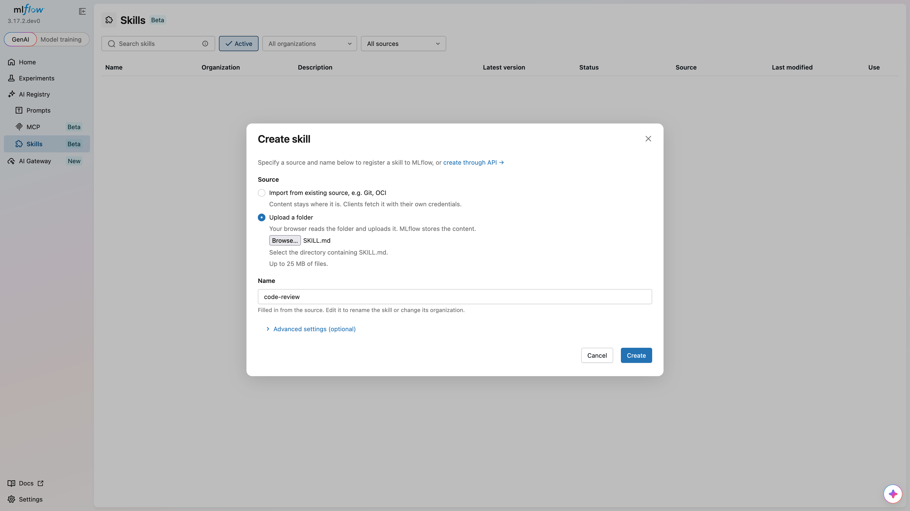
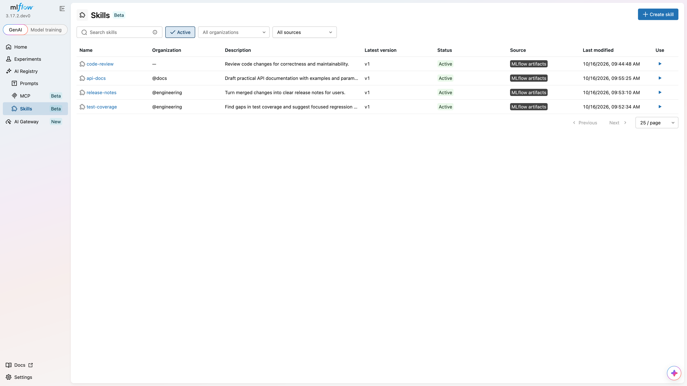
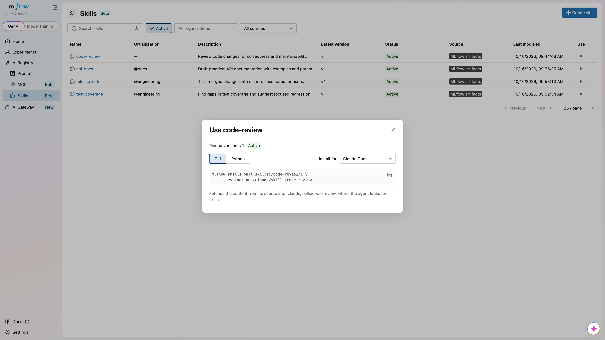

# Skill Registry

Experimental

Skill Registry is experimental. APIs and behavior may change in future releases.

**MLflow Skill Registry** provides a centralized catalog for registering, versioning, and sharing [agent skills](https://agentskills.io). A skill contains a `SKILL.md` file with instructions and can include supporting files, such as scripts and reference documents. Register skills so users can discover them, track their versions, and download them for use with their agents.

You can upload a local directory or register content from Git, an OCI registry, or a ZIP URL. Uploaded content is stored as MLflow artifacts. For external sources, the registry records where to fetch the content.

## Key Benefits[​](#key-benefits "Direct link to Key Benefits")

#### Centralized Catalog

Keep your organization's skills in one catalog, with descriptions, tags, and source information.

#### Version Control

Track changes with numbered versions. Manage draft, active, and deprecated versions, and assign aliases such as production.

#### Skill Discovery

Search registered skills by name, organization, status, source type, or tags. Import multiple skills from a Git repository.

#### Use with Your Agents

Download skills by version or alias. Get CLI and Python instructions for placing files where your agent loads skills.

## Getting Started[​](#getting-started "Direct link to Getting Started")

### 1. Register a Skill[​](#1-register-a-skill "Direct link to 1. Register a Skill")

What is SKILL.md?

`SKILL.md` contains the skill's instructions and YAML frontmatter that declares its name. Create a directory named `code-review` and save this example as `code-review/SKILL.md`:

markdown

```
---

name: code-review

description: Review code changes for correctness and maintainability.

---


# Code review


Read the proposed changes and their tests. Identify bugs, explain their impact,

and suggest focused fixes. Reference the affected files in your findings.
```

* UI
* Python
* CLI



1. Run `mlflow server` in your terminal to start the MLflow UI.
2. Navigate to **Skills** in the sidebar.
3. Click **Create skill**.
4. Select **Upload a folder** and choose the `code-review` directory.
5. Review the name read from `SKILL.md`.
6. Click **Create** to register the skill.

Set `MLFLOW_TRACKING_URI` to your running MLflow server before using the Python API.

Use [`mlflow.genai.register_skill()`](/docs/latest/api_reference/python_api/mlflow.genai.html#mlflow.genai.register_skill) to inspect and upload the directory:

python

```
import mlflow


version = mlflow.genai.register_skill(source="./code-review")

print(f"Registered '{version.name}' version {version.version}")
```

Set `MLFLOW_TRACKING_URI` to your running MLflow server before using the CLI.

bash

```
mlflow skills register --source ./code-review
```

Registration creates the parent skill if needed and defaults to `active` status. The first version is `1`; each subsequent single-skill registration creates a new integer version.

### 2. Browse Registered Skills[​](#2-browse-registered-skills "Direct link to 2. Browse Registered Skills")

* UI
* Python
* CLI



The **Skills** page displays the registered catalog. Search by name or filter by organization, status, and source type. Open a skill to inspect its versions, source, tags, and aliases.

Use [`mlflow.genai.search_skills()`](/docs/latest/api_reference/python_api/mlflow.genai.html#mlflow.genai.search_skills) to find registered skills:

python

```
import mlflow


skills = mlflow.genai.search_skills()

for skill in skills:

    print(f"{skill.name}: {skill.description}")


active_skills = mlflow.genai.search_skills(filter_string="status = 'active'")
```

bash

```
mlflow skills search --filter-string "status = 'active'" --output json
```

### 3. Pull a Skill[​](#3-pull-a-skill "Direct link to 3. Pull a Skill")

Pulling downloads a registered skill's files into a local directory.

* UI
* Python
* CLI



1. Click **Use** on a skill.
2. Choose your agent under **Install for**.
3. Select **CLI** or **Python** and copy the pull command.
4. Run the command in your environment to download the skill.

Use [`mlflow.genai.pull()`](/docs/latest/api_reference/python_api/mlflow.genai.html#mlflow.genai.pull) to download a specific version:

python

```
import mlflow


path = mlflow.genai.pull("skills:/code-review/1", destination="./downloaded-review")

print(path)
```

bash

```
mlflow skills pull skills:/code-review/1 --destination ./downloaded-review
```

The destination must be absent or an empty directory. Pulling downloads files; it does not execute the skill. Use a per-skill subdirectory, such as `.claude/skills/code-review`, as the destination to make the files available to your agent.

## Concepts[​](#concepts "Direct link to Concepts")

### Entity Model[​](#entity-model "Direct link to Entity Model")

| Entity           | Description                                                                                                                 |
| ---------------- | --------------------------------------------------------------------------------------------------------------------------- |
| **Skill**        | The parent entry, identified by name and optional organization within a workspace. Holds metadata, tags, and aliases.       |
| **SkillVersion** | A numbered version with a source, optional content digest, status, and version tags. Content changes require a new version. |
| **Alias**        | A name such as `production` that points to a version. The reserved `latest` alias resolves dynamically.                     |

### Skill Naming Convention[​](#skill-naming-convention "Direct link to Skill Naming Convention")

Skill names use 1–64 lowercase ASCII letters, digits, and hyphens. A name cannot start or end with a hyphen or contain consecutive hyphens.

An optional organization groups skills under a namespace:

text

```
code-review

@acme/code-review
```

These identify different skills. In Python calls, pass `organization="acme"` separately from `name="code-review"`. In skill URIs, use `skills:/@acme/code-review`.

### Status Lifecycle[​](#status-lifecycle "Direct link to Status Lifecycle")

Each skill version has a status:

text

```
draft ⇄ active ⇄ deprecated

  │                    │

  └───→ deleted ←──────┘
```

* **Draft**: The version is being prepared. It can still be pulled by version or alias.
* **Active**: The version is ready for use. Latest resolution prefers active versions.
* **Deprecated**: The version remains accessible but should be replaced.
* **Deleted**: The version is no longer available for normal reads or pulls.

### Access Control[​](#access-control "Direct link to Access Control")

When workspaces are enabled, skill identities and permissions are scoped to the active workspace. With MLflow authentication, `READ` permits reading and pulling skills, `EDIT` permits registering versions and updating metadata, and `MANAGE` permits deleting skills and versions. An organization name does not itself grant access.

Access to an external source is checked separately using the pulling user's credentials.

## Next Steps[​](#next-steps "Direct link to Next Steps")

* [Register and Import Skills](/docs/latest/genai/skill-registry/register-and-import-skills.md) — local uploads, external sources, and Git repository imports
* [Manage Versions and Aliases](/docs/latest/genai/skill-registry/manage-versions-and-aliases.md) — versioning, status lifecycle, aliases, and tags
* [Pull Skills](/docs/latest/genai/skill-registry/pull-skills.md) — pull instructions, version selection, and content verification
