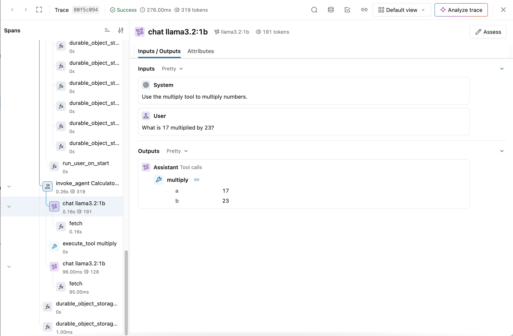

# Tracing Cloudflare Agents

[Cloudflare Agents](https://github.com/cloudflare/agents) is a TypeScript SDK for building stateful agents on Cloudflare Workers and Durable Objects. Its native tracing records agent operations, model calls, and tool executions. You can send these traces to [MLflow Tracing](/docs/latest/genai/tracing.md) through Cloudflare's OpenTelemetry export.


#### Integration via OpenTelemetry

Cloudflare Agents<!-- --> can be integrated with MLflow via OpenTelemetry. Configure <!-- -->Cloudflare Agents<!-- -->'s OpenTelemetry exporter to send traces to MLflow's OTLP endpoint.



The trace above shows a real agent calling the local `llama3.2:1b` model, executing `multiply(17, 23)`, and responding with `391`. The deployment example below uses OpenAI [GPT-6.1 Sol](https://developers.openai.com/api/docs/models/gpt-6.1-sol) through the Responses API; see [Local Development](#local-development) for how the screenshot's traces reached MLflow. MLflow recognizes the agent, model, and tool spans from their OpenTelemetry GenAI attributes.

## Step 1: Start the MLflow Tracking Server[​](#step-1-start-the-mlflow-tracking-server "Direct link to Step 1: Start the MLflow Tracking Server")

Start the MLflow server with [uv](https://docs.astral.sh/uv/). MLflow uses SQLite by default:

bash

```
uvx mlflow server --port 5000
```

In another terminal, create an experiment on this server and note its ID:

bash

```
export MLFLOW_TRACKING_URI=http://localhost:5000

uvx mlflow experiments create --experiment-name cloudflare-agents
```

For deployed Workers, the server must be reachable from Cloudflare. Expose it through an HTTPS endpoint using your [self-hosted MLflow deployment](/docs/latest/self-hosting.md). A server listening only on `localhost` cannot receive Cloudflare's hosted exports.

## Step 2: Create a Cloudflare OpenTelemetry Destination[​](#step-2-create-a-cloudflare-opentelemetry-destination "Direct link to Step 2: Create a Cloudflare OpenTelemetry Destination")

note

Hosted delivery to MLflow was not tested for this guide. The screenshot uses a local span relay; see [Local Development](#local-development).

In the Cloudflare dashboard, go to **Observability > Destinations**, select **Add destination**, and configure the [OpenTelemetry destination](https://developers.cloudflare.com/observability/export/opentelemetry/):

| Setting          | Value                                          |
| ---------------- | ---------------------------------------------- |
| Destination name | `mlflow-traces`                                |
| Destination type | **Traces**                                     |
| OTLP endpoint    | `https://<your-mlflow-host>/v1/traces`         |
| Custom headers   | `x-mlflow-experiment-id: <your-experiment-id>` |

Add any authentication headers required by your MLflow deployment, then save the destination. Cloudflare exports OTLP as JSON, which MLflow accepts at `/v1/traces`.

## Step 3: Enable Workers Tracing[​](#step-3-enable-workers-tracing "Direct link to Step 3: Enable Workers Tracing")

Add the destination name to your existing Wrangler configuration. The name must match the destination created in the dashboard:

wrangler.jsonc

json

```
{

  "name": "mlflow-calculator-agent",

  "main": "src/index.ts",

  "compatibility_date": "2026-10-19",

  "compatibility_flags": ["nodejs_compat"],

  "durable_objects": {

    "bindings": [

      { "name": "CalculatorAgent", "class_name": "CalculatorAgent" }

    ]

  },

  "migrations": [

    { "tag": "v1", "new_sqlite_classes": ["CalculatorAgent"] }

  ],

  "observability": {

    "enabled": true,

    "traces": {

      "enabled": true,

      "head_sampling_rate": 1,

      "destinations": ["mlflow-traces"]

    }

  }

}
```

This example samples every request. Adjust `head_sampling_rate` for your workload. For an existing agent, keep its Durable Object bindings and migrations, and add the `observability` configuration.

## Step 4: Trace Model and Tool Calls[​](#step-4-trace-model-and-tool-calls "Direct link to Step 4: Trace Model and Tool Calls")

For agents that call the Vercel AI SDK directly, wrap the SDK with Cloudflare's native instrumentation. This example uses AI SDK v6:

bash

```
npm install agents@0.30.1 ai@6 @ai-sdk/openai@3 zod@4

npm install --save-dev wrangler
```

src/index.ts

typescript

```
import { Agent, routeAgentRequest } from "agents";

import { wrapAISDK } from "agents/observability/ai";

import * as ai from "ai";

import { createOpenAI } from "@ai-sdk/openai";

import { z } from "zod";


const { generateText } = wrapAISDK(ai, {

  storeMessages: true,

  storeTools: true,

});


type Env = {

  OPENAI_API_KEY: string;

  CalculatorAgent: DurableObjectNamespace<CalculatorAgent>;

};


export class CalculatorAgent extends Agent<Env> {

  async onRequest(request: Request): Promise<Response> {

    const { prompt } = await request.json<{ prompt: string }>();

    const openai = createOpenAI({ apiKey: this.env.OPENAI_API_KEY });


    const result = await generateText({

      model: openai.responses("gpt-6.1-sol"),

      system: "Use the multiply tool to multiply numbers.",

      prompt,

      stopWhen: ai.stepCountIs(4),

      tools: {

        multiply: ai.tool({

          description: "Multiply two numbers.",

          inputSchema: z.object({ a: z.number(), b: z.number() }),

          execute: async ({ a, b }) => ({ product: a * b }),

        }),

      },

      experimental_telemetry: {

        functionId: "CalculatorAgent",

        metadata: { agentId: this.name },

      },

    });


    return Response.json({ text: result.text });

  }

}


export default {

  async fetch(request: Request, env: Env): Promise<Response> {

    return (

      (await routeAgentRequest(request, env)) ??

      new Response("Not found", { status: 404 })

    );

  },

} satisfies ExportedHandler<Env>;
```

`storeMessages` records model inputs and outputs, and `storeTools` records tool arguments and results. Both are off by default. Enable them for the payloads you want to inspect in MLflow. Input, output, and cache token usage is recorded when the model provider reports it.

The wrapper creates native Workers spans and uses the export destination configured above. It does not require a separate OpenTelemetry SDK or MLflow TypeScript SDK. See [Cloudflare's AI SDK tracing documentation](https://github.com/cloudflare/agents/blob/main/docs/agents/observability.md#ai-sdk-tracing) for additional options.

## Step 5: Deploy and View Traces[​](#step-5-deploy-and-view-traces "Direct link to Step 5: Deploy and View Traces")

Store the model provider key as a Worker secret, deploy with your project's Wrangler CLI, then send a request:

bash

```
npm exec -- wrangler secret put OPENAI_API_KEY

npm exec -- wrangler deploy


curl https://<your-worker-host>/agents/calculator-agent/demo \

  --json '{"prompt":"What is 17 multiplied by 23?"}'
```

Open your MLflow experiment and select the **Traces** tab. Expand `invoke_agent CalculatorAgent` and select a `chat` or `execute_tool` span to inspect its inputs and outputs. Cloudflare delivery can take several minutes; check the destination's status if traces do not appear.

The outer `POST` spans contain HTTP metadata. Model messages and tool payloads appear on their respective child spans. Spans named `durable_object_storage_exec` record SQL operations performed by the agent SDK and runtime.

## Local Development[​](#local-development "Direct link to Local Development")

`wrangler dev` records native spans in Local Explorer but does not forward them to Cloudflare's hosted export destinations. Setting `destinations` alone therefore does not send local development traces to MLflow.

The screenshot on this page comes from a real local Workers run using Agents 0.30.1 and MLflow 3.17.2. Its native spans were read from Local Explorer and relayed to MLflow as OTLP/HTTP JSON. This validated native span ingestion and model/tool payloads; Cloudflare's hosted delivery path was not exercised for that example.

## Next Steps[​](#next-steps "Direct link to Next Steps")

* [Collect OpenTelemetry traces into MLflow](/docs/latest/genai/tracing/opentelemetry/ingest.md)
* [Track token usage and cost](/docs/latest/genai/tracing/token-usage-cost.md)
* [Evaluate agents using traces](/docs/latest/genai/eval-monitor/running-evaluation/traces.md)
