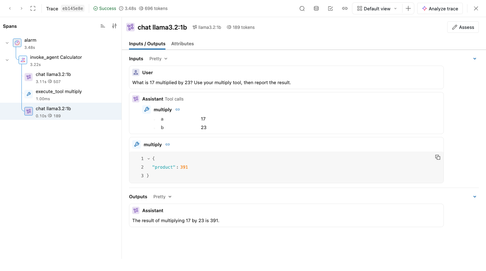

# Tracing Flue

[Flue](https://flueframework.com/) is a TypeScript agent framework. On Cloudflare Workers, Flue automatically records agent, model, and tool spans. You can send these traces to [MLflow Tracing](/docs/latest/genai/tracing.md) through Cloudflare's OpenTelemetry export.


#### Integration via OpenTelemetry

Flue<!-- --> can be integrated with MLflow via OpenTelemetry. Configure <!-- -->Flue<!-- -->'s OpenTelemetry exporter to send traces to MLflow's OTLP endpoint.



Captured via a local span relay. Cloudflare's hosted delivery was not tested; see Local Development below.

The trace above shows a real Flue 2.3 `Calculator` agent calling the local `llama3.2:1b` model, executing `multiply(17, 23)`, and answering `391`. The deployment example below uses Anthropic Claude Haiku 4.5; see [Local Development](#local-development) for the screenshot's trace capture and validation.

## Step 1: Start the MLflow Tracking Server[​](#step-1-start-the-mlflow-tracking-server "Direct link to Step 1: Start the MLflow Tracking Server")

bash

```
pip install --upgrade mlflow

mlflow server --backend-store-uri sqlite:///mlflow.db --port 5000
```

In another terminal, create an experiment on this server and note its ID:

bash

```
export MLFLOW_TRACKING_URI=http://localhost:5000

mlflow experiments create --experiment-name flue
```

For deployed Workers, expose the server through an HTTPS endpoint using your [self-hosted MLflow deployment](/docs/latest/self-hosting.md). Cloudflare's hosted exports cannot reach a server listening only on `localhost`.

## Step 2: Create a Cloudflare OpenTelemetry Destination[​](#step-2-create-a-cloudflare-opentelemetry-destination "Direct link to Step 2: Create a Cloudflare OpenTelemetry Destination")

note

Hosted delivery to MLflow was not tested for this guide. See [Local Development](#local-development) for the validation scope.

In the Cloudflare dashboard, go to **Observability > Destinations**, select **Add destination**, and configure an [OpenTelemetry destination](https://developers.cloudflare.com/observability/export/opentelemetry/):

| Setting          | Value                                          |
| ---------------- | ---------------------------------------------- |
| Destination name | `mlflow-traces`                                |
| Destination type | **Traces**                                     |
| OTLP endpoint    | `https://<your-mlflow-host>/v1/traces`         |
| Custom headers   | `x-mlflow-experiment-id: <your-experiment-id>` |

Add any authentication headers required by your MLflow deployment, then save the destination. Cloudflare exports OTLP as JSON, which MLflow accepts at `/v1/traces`.

## Step 3: Enable Workers Tracing[​](#step-3-enable-workers-tracing "Direct link to Step 3: Enable Workers Tracing")

wrangler.jsonc

json

```
{

  "$schema": "./node_modules/wrangler/config-schema.json",

  "name": "mlflow-flue-agent",

  "compatibility_date": "2026-10-19",

  "compatibility_flags": ["nodejs_compat"],

  "migrations": [

    { "tag": "v1", "new_sqlite_classes": ["FlueCalculatorAgent"] }

  ],

  "observability": {

    "enabled": true,

    "traces": {

      "enabled": true,

      "head_sampling_rate": 1,

      "destinations": ["mlflow-traces"]

    }

  }

}
```

The destination name must match Step 2. This example samples every request; adjust `head_sampling_rate` for your workload. Flue generates the Worker entry point and Durable Object bindings; Wrangler supplies the migration for `FlueCalculatorAgent`. For an existing project, preserve its bindings and deployed migration history. See [Flue's Cloudflare deployment guide](https://flueframework.com/docs/ecosystem/deploy/cloudflare/) for migration requirements.

## Step 4: Create a Flue Agent[​](#step-4-create-a-flue-agent "Direct link to Step 4: Create a Flue Agent")

Use Node.js 22.19 or later. In your project directory, install Flue and the Cloudflare Vite integration:

bash

```
npm init -y

npm pkg set type=module

npm install @flue/runtime@^2.3.0 hono valibot

npm install --save-dev @flue/vite@^2.3.0 @cloudflare/vite-plugin vite@^8 wrangler

mkdir -p src/agents
```

Configure Vite with `flue()` before `cloudflare()`, and pass Flue's generated Worker configuration to the Cloudflare plugin:

vite.config.ts

typescript

```
import { cloudflare } from "@cloudflare/vite-plugin";

import { flue, flueWorkerConfig } from "@flue/vite";

import { defineConfig } from "vite";


export default defineConfig({

  plugins: [flue(), cloudflare({ config: flueWorkerConfig() })],

});
```

src/agents/calculator.ts

typescript

```
"use agent";


import { useModel, useTool } from "@flue/runtime";

import * as v from "valibot";


export function Calculator() {

  useModel("anthropic/claude-haiku-4-5");

  useTool({

    name: "multiply",

    description: "Multiply two numbers.",

    input: v.object({ a: v.number(), b: v.number() }),

    async run({ data }) {

      return { output: { product: data.a * data.b } };

    },

  });

  return "Use the multiply tool to multiply numbers, then report the result.";

}
```

src/app.ts

typescript

```
import { createAgentRouter } from "@flue/runtime/routing";

import { Hono } from "hono";

import { Calculator } from "./agents/calculator.ts";


const app = new Hono();

app.route("/agents/calculator", createAgentRouter(Calculator));


export default app;
```

Flue's [native tracing](https://flueframework.com/docs/guide/observability/) emits `invoke_agent`, `chat`, and `execute_tool` spans with OpenTelemetry GenAI attributes. Conversation and tool payloads are recorded by default, along with token usage when the provider reports it.

### Control Recorded Content[​](#control-recorded-content "Direct link to Control Recorded Content")

To disable payload capture, replace the default tracing configuration at module scope in `src/app.ts`. Use a [content transform](https://flueframework.com/docs/guide/cloudflare-target/#createcloudflaretracing) to redact selected fields instead.

typescript

```
import { instrument } from "@flue/runtime";

import { createCloudflareTracing } from "@flue/runtime/cloudflare";


instrument(createCloudflareTracing({ content: false }));
```

## Step 5: Deploy and View Traces[​](#step-5-deploy-and-view-traces "Direct link to Step 5: Deploy and View Traces")

Build the Worker, store the model provider key as a Worker secret, deploy, and send a request:

bash

```
npm exec -- vite build

npm exec -- wrangler deploy --dry-run # Validate the bundle without deploying.

npm exec -- wrangler secret put ANTHROPIC_API_KEY

npm exec -- wrangler deploy


curl https://<your-worker-host>/agents/calculator/demo \

  --json '{"kind":"user","body":"What is 17 multiplied by 23?"}'
```

The request returns an HTTP `202` admission response while the agent runs in its Durable Object. Read the conversation after the agent completes:

bash

```
curl 'https://<your-worker-host>/agents/calculator/demo?view=history'
```

Open your MLflow experiment and select the **Traces** tab. Expand the `invoke_agent` span and select its `chat` and `execute_tool` children to inspect the model messages, the `multiply` call, and its result. Cloudflare delivery can take several minutes; check the destination's status if traces do not appear.

## Local Development[​](#local-development "Direct link to Local Development")

Run `npm exec -- vite dev` to develop the Worker locally. For local model calls, set `ANTHROPIC_API_KEY` in a `.dev.vars` file as described in [Flue's Cloudflare deployment guide](https://flueframework.com/docs/ecosystem/deploy/cloudflare/#5-add-your-api-key). Native spans appear in Cloudflare's Local Explorer, but local development does not forward them to Cloudflare's hosted export destinations. The destination configuration above sends traces from deployed Workers.

The screenshot uses a real Flue 2.3 `Calculator` agent with the `llama3.2:1b` model connected through Flue's [custom-provider API](https://flueframework.com/docs/guide/models/). Its native spans were read from Local Explorer and relayed to MLflow 3.17.2 as OTLP/HTTP JSON, then imported unchanged into Databricks MLflow for the screenshot. MLflow recognized the agent, model, and tool spans, including messages, tool arguments and results, and token usage. Cloudflare's hosted delivery path was not exercised.

For exporting traces directly from a Node.js Flue application, use [`@flue/opentelemetry`](https://flueframework.com/docs/ecosystem/tooling/opentelemetry/) with an OpenTelemetry SDK and an OTLP/HTTP trace exporter configured for MLflow's `/v1/traces` endpoint and `x-mlflow-experiment-id` header. See [Collect OpenTelemetry traces into MLflow](/docs/latest/genai/tracing/opentelemetry/ingest.md).

## Next Steps[​](#next-steps "Direct link to Next Steps")

* [Trace Cloudflare Agents](/docs/latest/genai/tracing/integrations/listing/cloudflare-agents.md)
* [Track token usage and cost](/docs/latest/genai/tracing/token-usage-cost.md)
* [Evaluate agents using traces](/docs/latest/genai/eval-monitor/running-evaluation/traces.md)
